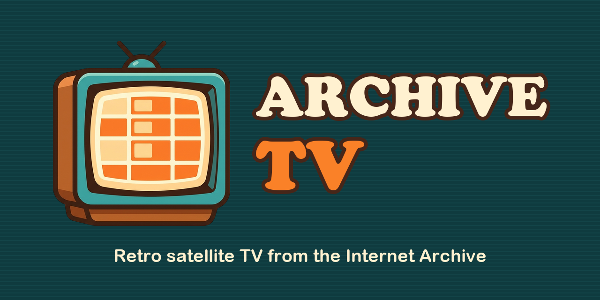

<p align="center"></p>

<p align="center">
<a href="https://github.com/dontaco2000/archive-tv/releases/latest"></a>
<a href="LICENSE"></a>

</p>

# Archive TV

A retro "satellite TV" app. It plays video from the [Internet Archive](https://archive.org) as live, clock-synced channels with an on-screen guide, a menu, and a remote control. Turn it on and something is always "on", just like a TV.

- **Windows** (primary) and **Android** (Fire TV, Android TV, phones and tablets).
- 61 channels, 15-minute guide, favorites, On Demand by genre and show with search, sleep timer, parental controls (PIN), a night-only adult mode (R-rated and similar content airs only from 22:00 to 05:00; On Demand lists it any time, marked R, unless parental controls turn adult mode off), and a WeatherStar-style weather channel.
- A **phone remote**: scan the QR code in the menu (Remote > Phone remote) and control Archive TV from any phone browser on the same Wi-Fi (Windows and Fire TV / Android TV).
- Built with Flutter, media_kit and libmpv. A pure-Dart core (`core/`) handles channels, pools and scheduling; the app is in `player/`.

## Content disclaimer

**We are not responsible for the content.** All video and audio comes from the Internet Archive (archive.org) and its uploaders. Archive TV only indexes and plays it. Archive TV is **not affiliated with or endorsed by the Internet Archive.** Some channels (such as Headliner, Teaser, Haunt and Bedlam) and the night-time blocks on many others can include mature content (strong language, violence, crude humor, sports like MMA); parental controls can lock them. The weather page is third-party (WeatherStar 4000+ by Matt Walsh, MIT) and weather data comes from Open-Meteo and the National Weather Service.

## Install

**Latest release: [github.com/dontaco2000/archive-tv/releases/latest](https://github.com/dontaco2000/archive-tv/releases/latest)** (always the newest version, with release notes).

**Windows**

1. Download [`ArchiveTV-Setup.exe`](https://github.com/dontaco2000/archive-tv/releases/latest/download/ArchiveTV-Setup.exe) and run it (per-user install, no admin needed).
2. Windows SmartScreen may warn that the installer is unsigned. Click **More info**, then **Run anyway**.
3. The Microsoft WebView2 runtime is downloaded automatically if your PC doesn't have it.
4. An internet connection is required (every channel streams from archive.org). On first run press **Refresh channels** in the menu.

**Android**

The APKs are signed with a debug key and must be sideloaded (they are not on any store). Pick the right file:

| Device | APK |
|---|---|
| Fire TV Stick Lite, most Fire TV / Android TV boxes, older phones | [`ArchiveTV-32bit.apk`](https://github.com/dontaco2000/archive-tv/releases/latest/download/ArchiveTV-32bit.apk) |
| Modern phones and tablets (64-bit) | [`ArchiveTV-64bit.apk`](https://github.com/dontaco2000/archive-tv/releases/latest/download/ArchiveTV-64bit.apk) |

On a phone or tablet the video is a 4:3 box with an on-screen remote below or beside it. On a TV, use the remote's D-pad.

## Testing status

- Windows: tested on real hardware.
- Fire Stick Lite: the 32-bit APK, TV layout, tested on a real device.
- Phone remote (QR code, browser page): tested on a real iPhone against the Windows app; the Fire TV side of it is untested on a real network. Windows may ask to allow the app on private networks the first time you turn it on.
- **The phone and tablet version (touch layout, 64-bit APK) was only tested in an emulator (BlueStacks), not on real phones or tablets.** Expect rough edges.

## Known limits

- Android has no automatic black-bar cropping and no volume leveling (both need a fuller libmpv build).
- Content comes and goes on the Internet Archive; Archive TV skips items that can't be reached and re-checks them weekly.

## Build from source

Requires Flutter (see `player/pubspec.yaml` for the SDK version), and Visual Studio C++ build tools for Windows or the Android SDK and JDK 21 for Android.

```
cd core && dart test
cd ../player && flutter test
flutter build windows --release
flutter build apk --release --target-platform android-arm     # 32-bit
flutter build apk --release --target-platform android-arm64   # 64-bit
```

The Windows build downloads a full-featured `libmpv-2.dll` on first build (`player/windows/fetch_libmpv.ps1`, checksum verified). Channels are defined in `player/assets/channels.json`.

## Porting and forks

Archive TV is licensed under the **GNU General Public License v3.0** (see `LICENSE`). If you port it to another platform or modify it, the GPL requires that you share your source under the same license. We ask that you publish your port as a **fork of this project** so improvements stay connected.

## Credits

- [Internet Archive](https://archive.org): all video and audio.
- [WeatherStar 4000+](https://weatherstar.netbymatt.com) by Matt Walsh (MIT): the weather channel page.
- [Open-Meteo](https://open-meteo.com) and the [National Weather Service](https://www.weather.gov): weather data.
- [media_kit](https://github.com/media-kit/media-kit) and [mpv](https://mpv.io) / FFmpeg: playback.
- [Flutter](https://flutter.dev), [flutter_inappwebview](https://inappwebview.dev) and Microsoft WebView2.
